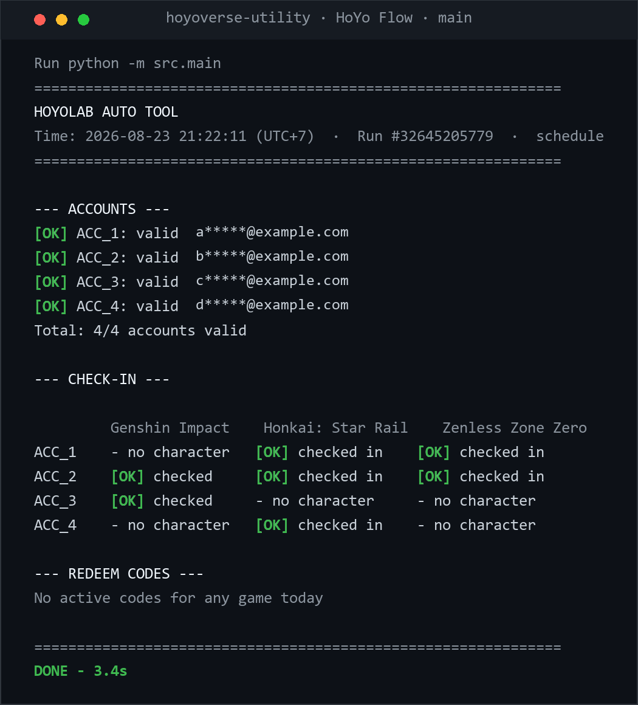
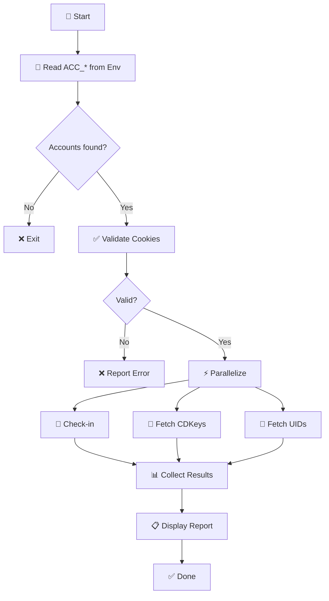

# HoYoLab Auto Tool

Automated daily check-in & redeem codes for **Genshin Impact**, **Honkai: Star Rail** and **Zenless Zone Zero** — free, multi-account, runs entirely in GitHub Actions.

> ⚠️ **Disclaimer:** This is a personal-use automation tool. Automating game actions may violate the HoYoverse Terms of Service — use at your own risk.

<p align="center">
  
</p>

If this saves you time, a ⭐ star helps others find it.

[](https://www.python.org/downloads/)
[](LICENSE)
[](https://github.com/psf/black)

## Why this tool

- **Bounded async engine** — check-in and read-only fetches use the shared semaphore; redemption preserves sequential code/region order
- **Multi-account native** — add `ACC_1` … `ACC_4` secrets and you're done; no config files to edit
- **All 3 games, including Zenless Zone Zero** — some older helpers never added ZZZ
- **Fork-and-forget** — zero local runtime; GitHub Actions runs it daily
- **Tested** — unit + integration suite with a CI coverage gate on every push

The best-known helper in this niche (`y1ndan/genshin-impact-helper`) was removed from GitHub, leaving fewer maintained options — this project aims to fill that gap with a modern, tested codebase.

| | This tool | Typical older helper | Manual |
|---|---|---|---|
| Games incl. ZZZ | ✅ | varies | — |
| Multi-account | ✅ native `ACC_*` | config file | — |
| Bounded async requests | ✅ semaphore | varies | — |
| Setup effort | fork + secrets | fork + config edit | daily login |

## Quick Start

1. **Fork** this repository (top-right on GitHub).
2. **Copy your HoYoLAB cookie:**
   1. Log in at [HoYoLab](https://www.hoyolab.com), open avatar → *Personal Homepage*
   2. DevTools (F12) → *Network* tab → find request `getGameRecordCard?uid=...`
   3. Copy the full `Cookie:` header value
3. **Add the secret:** in your fork → *Settings* → *Secrets and variables* → *Actions* → new repository secret named `ACC_1`, paste the cookie. Repeat with `ACC_2` through `ACC_4` for more accounts. Local runs read all nonempty `ACC_*` variables; the supplied workflow explicitly exposes four secrets.
4. **Run:** *Actions* → *HoYo Flow* → *Run workflow*. After that it runs automatically every day at **04:45 (UTC+7)**.
5. **Check the report tables** in the run log — done in seconds.

> 🔐 Your cookie lives only in encrypted [GitHub Secrets](https://docs.github.com/en/actions/security-guides/using-secrets-in-github-actions) and is sent exclusively to official HoYoLAB API endpoints. Never paste cookies into issues or logs.

## Supported games

| Game | Check-in | Redeem |
|------|----------|--------|
| Genshin Impact | ✅ | ✅ |
| Honkai: Star Rail | ✅ | ✅ |
| Zenless Zone Zero | ✅ | ✅ |

## Example output

<details>
<summary>Example run log (click to expand; statuses translated from runtime Vietnamese)</summary>

```
HOYOLAB AUTO TOOL · 2026-10-16 22:46:20 · trace c1d21ecb

ACCOUNTS  2/2 valid
  ACC_1  a****@example.com
  ACC_2  b****@example.com

CHECK-IN
  Account  GI   HSR  ZZZ
  ACC_1    d15  ok   ok
  ACC_2    ok   ok   --
  d<N> claimed today · ok already claimed · -- no character yet · ERR failed

REDEEM
  Genshin Impact: 3 codes [ABC, DEF, XYZ]
UIDs:
  ACC_1: Genshin Impact(asia)
  ACC_2: Genshin Impact(asia, usa)

[Genshin Impact]
Account   Region  ABC   DEF   XYZ
ACC_1     asia    ok    ok    ERR [-2017] Provider message
ACC_2     asia    ok    ok    ERR [-2017] Provider message
          usa     ok    ok    ERR [-2017] Provider message

RESULT  OK · 5 checked in · 1 no character yet · 0 errors · 4.2s
```

</details>

On GitHub Actions each run also publishes the check-in table to the job summary, and failures appear as workflow annotations.

## How it works



## Advanced configuration

<details>
<summary>Environment variables & tuning</summary>

| Variable | Description | Default |
|----------|-------------|---------|
| `ACC_*` | Cookie strings (`ACC_1`, `ACC_2`, …) | required |
| `DEBUG` | Enable debug-level logging | `""` |

Runtime settings and defaults are owned by [`src/config.py`](src/config.py):

- `SEMAPHORE_LIMIT` and connector limits bound concurrency.
- `REDEEM_DELAY_SECONDS` preserves the delay between codes in a region.
- `MAX_ATTEMPTS` includes the initial request; it is not an additional retry count.
- `REQUEST_TIMEOUT_SECONDS`, `MIN_ATTEMPT_TIMEOUT_SECONDS` and `CONNECT_TIMEOUT_SECONDS` bound each attempt. Backoff and later attempts can make the complete operation take longer.
- `RATE_LIMIT_DELAY_SECONDS` supplies the default HTTP 429 backoff.


</details>

<details>
<summary>Troubleshooting</summary>

**Invalid cookie**
```
[✗] ACC_1: Missing required cookies: ['account_id_v2']
```
Re-grab the cookie from HoYoLab and make sure it contains `_MHYUUID`, `_HYVUUID`, `cookie_token_v2`, `account_id_v2`.

**No accounts found**
```
[SYSTEM] No accounts found in environment variables!
```
Check that secret names match exactly (`ACC_1`, `ACC_2`, …) and re-run the workflow manually.

**Rate limited (429)**
Wait and re-run later; reduce account count if it persists; limits reset after ~24 h.

**A code fails**
The report keeps the provider message and retcode for that code and region. Numeric HoYoLAB retcodes are not interpreted as permanent expiry or region ineligibility. New codes arrive via livestreams/events.

</details>

<details>
<summary>Project structure</summary>

```
hoyoverse-utility/
├── .github/workflows/
│   ├── hoyo-flow.yml          # Daily-run workflow
│   └── test.yml               # CI: tests + coverage gate
├── src/
│   ├── main.py                # Entry point / orchestration
│   ├── config.py              # Central config
│   ├── constants.py           # Shared constants
│   ├── api/
│   │   ├── client.py          # JSON transport + provider-envelope parsing
│   │   ├── request_builder.py # Browser/RPC headers and game-specific requests
│   │   ├── checkin.py         # Check-in APIs
│   │   ├── redeem_fetch.py    # CDKey & UID fetching (read-only)
│   │   └── redeem_exchange.py # Code redemption (write)
│   ├── models/                # Immutable metadata and results.py contracts
│   └── utils/                 # CLI display, environment, timekeeping, logging
├── tests/                     # Unit + integration + API-health suites
├── requirements/              # SPEC & architecture docs
└── pytest.ini
```

</details>

## Local development

```bash
git clone https://github.com/cuupham/hoyoverse-utility.git
cd hoyoverse-utility

python -m venv .venv
.\.venv\Scripts\activate        # Windows
# source .venv/bin/activate     # Linux/Mac

pip install -r requirements.txt

# Optional: run against real accounts locally
# copy tests/auth/cookies.ps1.example -> tests/auth/.env.ps1, fill in cookies
.\tests\auth\.env.ps1
python -m src.main

# Tests (mock data, no cookie needed)
pip install -r requirements-dev.txt
python -m black --check src tests
python -m ruff check src tests
python -m mypy src
python -m pytest tests/unit tests/integration --cov=src --cov-report=term-missing --cov-fail-under=95

# Live read-only API health tests (need real cookies: ACC_1 env var or tests/auth/.env.ps1; no sign/redeem writes)
python -m pytest tests/api_health -m live -v
```

This repository is a CLI application. `src/api/` contains outbound HoYoLAB clients; it does not host a web API or frontend. See the [architecture](requirements/architecture.md) for module ownership.

A run exits with code 1 for account-validation failures, unrecovered fetch errors, check-in failures/challenges, redemption transport/schema errors, or codes with no eligible code/game/UID combination anywhere in the run. Healthy independent work finishes first. A known no-character result and provider-level redemption rejections remain reported without failing an otherwise healthy run. Cookie-check outages are reported separately from invalid credentials.

The optional read-only diagnostic uses the same credential loader and production wrappers, without printing account IDs or UIDs:

```bash
python tests/scripts/debug_checkin_info.py --help
# With real credentials, reads only; never signs in or redeems:
python tests/scripts/debug_checkin_info.py
```

See [CONTRIBUTING.md](CONTRIBUTING.md) before opening a PR.

## FAQ

<details>
<summary><b>Is my cookie safe?</b></summary>

It's stored in GitHub's encrypted Secrets service, injected only into your own workflow runs, and transmitted only to official HoYoLAB endpoints. Run logs mask emails (`a****@example.com`). Still, treat cookies like passwords: rotate them periodically and never commit them.
</details>

<details>
<summary><b>Will I get banned?</b></summary>

Honestly — maybe. Automating check-ins/redeems sits in a gray zone of the HoYoverse Terms of Service. Many people have used such tools without issues, but there is no guarantee, and HoYoverse could tighten enforcement at any time. Use it on accounts you're willing to risk.
</details>

<details>
<summary><b>How is this different from other helpers?</b></summary>

See the comparison table above: native multi-account via secrets (no config editing), bounded async reads, sequential redemption ordering, and ZZZ support out of the box — plus a tested, CI-gated codebase.
</details>

<details>
<summary><b>HoYo changed something and it broke!</b></summary>

HoYoLAB APIs change without notice. Check [Issues](../../issues) for existing reports, and open one if new — include the failing workflow log (with cookies removed).
</details>

## License

[MIT](LICENSE) — personal use at your own risk.

---

<p align="center">Made with ❤️ for Travelers, Trailblazers & Proxies</p>
