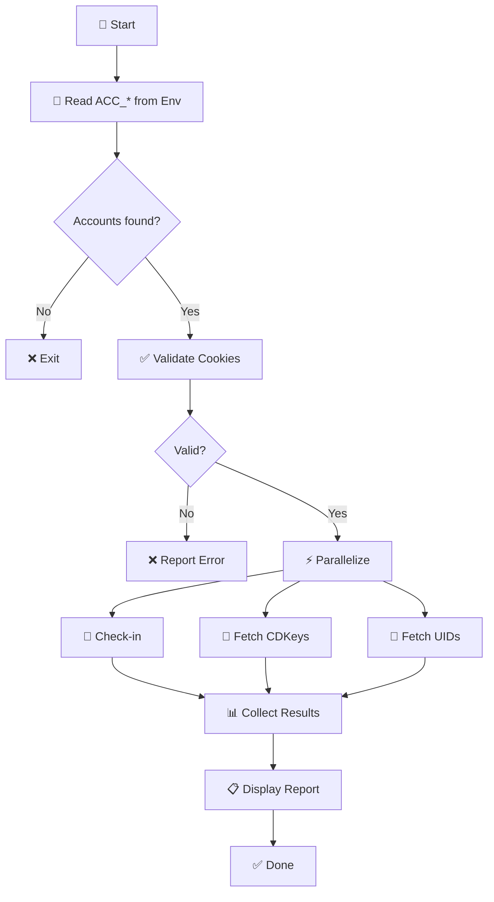

# HoYoLab Auto Tool

Automated daily check-in & redeem codes for **Genshin Impact**, **Honkai: Star Rail** and **Zenless Zone Zero** — free, multi-account, runs entirely in GitHub Actions.

> ⚠️ **Disclaimer:** This is a personal-use automation tool. Automating game actions may violate the HoYoverse Terms of Service — use at your own risk.

<p align="center">
  
</p>

If this saves you time, a ⭐ star helps others find it.

[](https://www.python.org/downloads/)
[](LICENSE)
[](https://github.com/psf/black)

## Why this tool

- **Parallel engine** — semaphore-based concurrency across accounts × games × regions; a full check-in + redeem run finishes in ~1.5 s
- **Multi-account native** — add `ACC_1` … `ACC_4` secrets and you're done; no config files to edit
- **Cross-region smart skip** — once a code fails in one region, it's auto-skipped downstream to save API budget
- **All 3 games, including Zenless Zone Zero** — some older helpers never added ZZZ
- **Fork-and-forget** — zero local runtime; GitHub Actions runs it daily
- **Tested** — unit + integration suite with a CI coverage gate on every push

The best-known helper in this niche (`y1ndan/genshin-impact-helper`) was removed from GitHub, leaving fewer maintained options — this project aims to fill that gap with a modern, tested codebase.

| | This tool | Typical older helper | Manual |
|---|---|---|---|
| Games incl. ZZZ | ✅ | varies | — |
| Multi-account | ✅ native `ACC_*` | config file | — |
| Parallel redeem | ✅ semaphore | sequential | — |
| Setup effort | fork + secrets | fork + config edit | daily login |

## Quick Start

1. **Fork** this repository (top-right on GitHub).
2. **Copy your HoYoLAB cookie:**
   1. Log in at [HoYoLab](https://www.hoyolab.com), open avatar → *Personal Homepage*
   2. DevTools (F12) → *Network* tab → find request `getGameRecordCard?uid=...`
   3. Copy the full `Cookie:` header value
3. **Add the secret:** in your fork → *Settings* → *Secrets and variables* → *Actions* → new repository secret named `ACC_1`, paste the cookie. Repeat with `ACC_2`+ for more accounts.
4. **Run:** *Actions* → *HoYo Flow* → *Run workflow*. After that it runs automatically every day at **04:45 (UTC+7)**.
5. **Check the report tables** in the run log — done in seconds.

> 🔐 Your cookie lives only in encrypted [GitHub Secrets](https://docs.github.com/en/actions/security-guides/using-secrets-in-github-actions) and is sent exclusively to official HoYoLAB API endpoints. Never paste cookies into issues or logs.

## Supported games

| Game | Check-in | Redeem |
|------|----------|--------|
| Genshin Impact | ✅ | ✅ |
| Honkai: Star Rail | ✅ | ✅ |
| Zenless Zone Zero | ✅ | ✅ |

## Example output

<details>
<summary>Example run log (click to expand; statuses translated from runtime Vietnamese)</summary>

```
--- ACCOUNTS ---
[✓] ACC_1: Valid (u****@gmail.com)
[✓] ACC_2: Valid (c****@gmail.com)

--- CHECK-IN ---
Account   Genshin Impact     Honkai: Star Rail   Zenless Zone Zero
ACC_1     ✓ Day 15           ✓ Already claimed   ✓ Already claimed
ACC_2     ✓ Already claimed  ✓ Already claimed   — No character yet

--- REDEEM CODE ---
Genshin Impact: 3 codes [ABC, DEF, XYZ]
Account   Region  ABC           DEF           XYZ
ACC_1     asia    ✓ Success     ✓ Success     ⏭ Skip
ACC_2     asia    ✓ Success     ✓ Success     ⏭ Skip
          usa     ✓ Success     ✓ Success     ⏭ Skip

DONE - 1.5s
```

</details>

## How it works



## Advanced configuration

<details>
<summary>Environment variables & tuning</summary>

| Variable | Description | Default |
|----------|-------------|---------|
| `ACC_*` | Cookie strings (`ACC_1`, `ACC_2`, …) | required |
| `DEBUG` | Enable debug-level logging | `""` |

Tunables in [`src/config.py`](src/config.py):

```python
SEMAPHORE_LIMIT = 20      # max parallel requests
REDEEM_DELAY = 5          # seconds between redeems
REQUEST_TIMEOUT = 30      # per-request timeout (s)
MIN_REQUEST_TIMEOUT = 15  # floor timeout per attempt
CONNECT_TIMEOUT = 10      # connect timeout (s)
MAX_RETRIES = 3           # retries on failure
RATE_LIMIT_DELAY = 5      # backoff on HTTP 429 (s)
HEADER_WIDTH = 50         # display header width
```

</details>

<details>
<summary>Troubleshooting</summary>

**Invalid cookie**
```
[✗] ACC_1: Missing required cookies: ['account_id_v2']
```
Re-grab the cookie from HoYoLab and make sure it contains `_MHYUUID`, `_HYVUUID`, `cookie_token_v2`, `account_id_v2`.

**No accounts found**
```
ERROR: No accounts found in environment variables!
```
Check that secret names match exactly (`ACC_1`, `ACC_2`, …) and re-run the workflow manually.

**Rate limited (429)**
Wait and re-run later; reduce account count if it persists; limits reset after ~24 h.

**Codes keep getting skipped**
`⏭ Skip` means the code is expired/invalid — it was already rejected in an earlier region and is skipped downstream to save requests. New codes arrive via livestreams/events.

</details>

<details>
<summary>Project structure</summary>

```
hoyoverse-utility/
├── .github/workflows/
│   ├── hoyo-flow.yml          # Daily-run workflow
│   └── test.yml               # CI: tests + coverage gate
├── src/
│   ├── main.py                # Entry point / orchestration
│   ├── config.py              # Central config
│   ├── constants.py           # Shared constants
│   ├── api/
│   │   ├── client.py          # HTTP client (retry, semaphore, anti-detection)
│   │   ├── checkin.py         # Check-in APIs
│   │   ├── redeem_fetch.py    # CDKey & UID fetching (read-only)
│   │   └── redeem_exchange.py # Code redemption (write)
│   ├── models/                # Account / game models, typed API results
│   └── utils/                 # Display, headers, logging, helpers
├── tests/                     # Unit + integration + API-health suites
├── requirements/              # SPEC & architecture docs
└── pytest.ini
```

</details>

## Local development

```bash
git clone https://github.com/cuupham/hoyoverse-utility.git
cd hoyoverse-utility

python -m venv .venv
.\.venv\Scripts\activate        # Windows
# source .venv/bin/activate     # Linux/Mac

pip install -r requirements.txt

# Optional: run against real accounts locally
# copy tests/auth/cookies.ps1.example -> tests/auth/.env.ps1, fill in cookies
.\tests\auth\.env.ps1
python -m src.main

# Tests (mock data, no cookie needed)
pip install pytest pytest-asyncio pytest-cov
python -m pytest --cov=src --cov-report=term-missing

# Live API health tests (need real cookies: ACC_1 env var or tests/auth/.env.ps1)
python -m pytest -m live -v
```

See [CONTRIBUTING.md](CONTRIBUTING.md) before opening a PR.

## FAQ

<details>
<summary><b>Is my cookie safe?</b></summary>

It's stored in GitHub's encrypted Secrets service, injected only into your own workflow runs, and transmitted only to official HoYoLAB endpoints. Run logs mask emails (`u****@gmail.com`). Still, treat cookies like passwords: rotate them periodically and never commit them.
</details>

<details>
<summary><b>Will I get banned?</b></summary>

Honestly — maybe. Automating check-ins/redeems sits in a gray zone of the HoYoverse Terms of Service. Many people have used such tools without issues, but there is no guarantee, and HoYoverse could tighten enforcement at any time. Use it on accounts you're willing to risk.
</details>

<details>
<summary><b>How is this different from other helpers?</b></summary>

See the comparison table above: native multi-account via secrets (no config editing), semaphore-based parallel execution (~1.5 s full runs), cross-region redeem skip, and ZZZ support out of the box — plus a tested, CI-gated codebase.
</details>

<details>
<summary><b>HoYo changed something and it broke!</b></summary>

HoYoLAB APIs change without notice. Check [Issues](../../issues) for existing reports, and open one if new — include the failing workflow log (with cookies removed).
</details>

## License

[MIT](LICENSE) — personal use at your own risk.

---

<p align="center">Made with ❤️ for Travelers, Trailblazers & Proxies</p>
